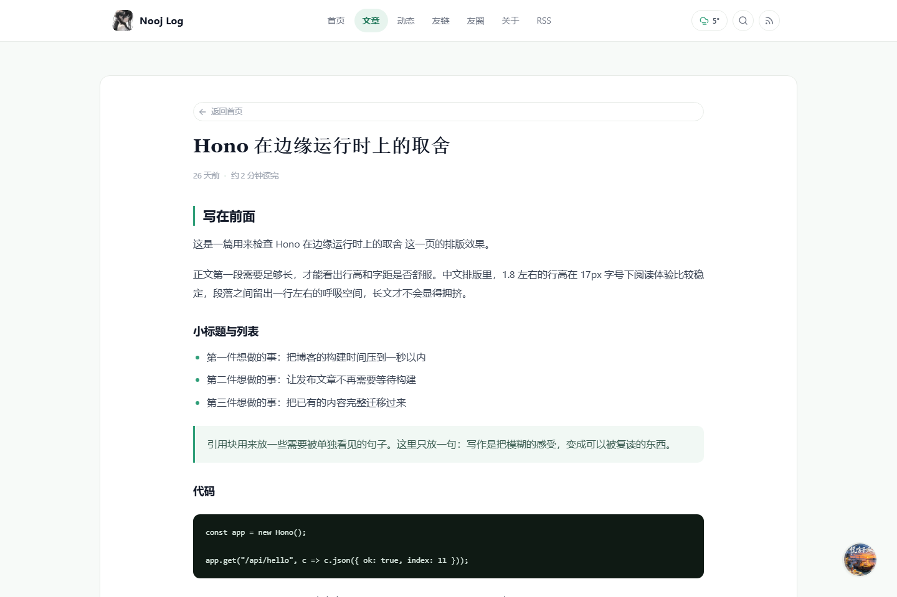
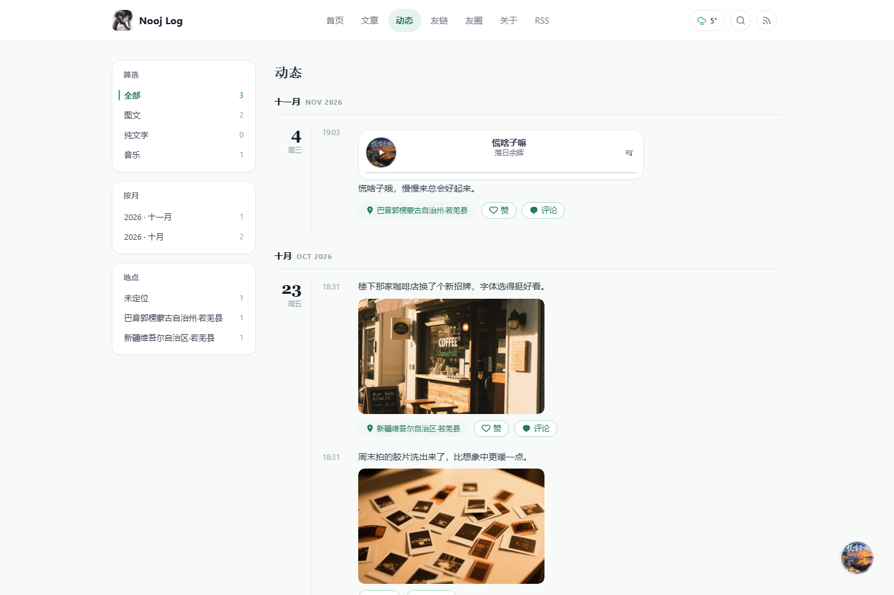
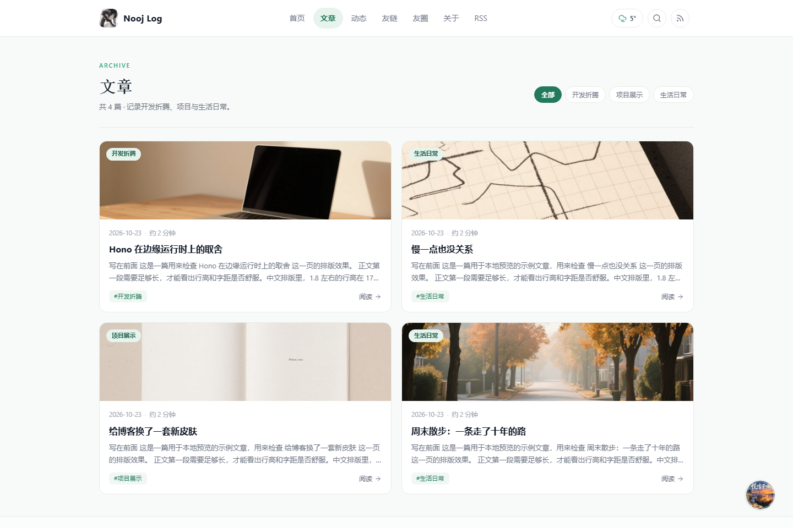

# Nooj Log

> 代码与生活，皆有迹可循

自托管个人博客：Hono + SQLite + 原生前端，单进程运行，发文即时生效，无需等待构建。
线上站点：<https://nooj.cn>


| 文章详情 | 动态 |
| --- | --- |
|  |  |



## 特性

**内容**

- 文章：Markdown 写作、封面、分类、置顶、阅读进度、侧边目录
- 动态：图文 / 音乐卡片、按类型、月份、地点筛选、点赞、评论
- 相册瀑布流、友链、友圈（订阅友站文章）
- 全站搜索、标签、归档

**交互与阅读**

- 浅色暖调主题，支持深浅色切换
- 图片灯箱、音乐胶囊（卡片播放 + 歌词）、天气胶囊
- 评论楼中楼、表情、图片、AI 自动回复
- 移动端适配，无横向溢出

**后台**

- 独立秘密路径入口（默认 `/admin`，可改为随机路径，公开 `/admin` 返回 404）
- 集中设置中心：站点信息、导航、评论、存储、通知、主题外观
- 内容管理：文章、动态、相册、友链、评论审核、项目展示、侧栏嵌入
- 存储可选本地磁盘 / Cloudflare R2 / Backblaze B2
- 插件与审计日志、数据备份导出

**SEO 与性能**

- 首页、文章列表、文章页、相册、友链服务端直出，爬虫可抓到正文
- RSS、sitemap、canonical、Open Graph、JSON-LD、IndexNow 推送
- 发布即落库即刻生效，无构建延迟；静态资源长缓存 + `?v=` 版本号击穿

## 技术栈

| 层 | 选型 |
| --- | --- |
| 运行时 | Node.js 22+ |
| 服务端 | Hono 4 + TypeScript |
| 数据库 | SQLite（better-sqlite3），单文件存储 |
| 构建 | esbuild（秒级构建，产物 `dist/server.mjs`） |
| 前端 | 原生 JS + CSS，无框架、无打包，主题可切换 |
| 部署 | 单容器（1Panel / Docker）+ CDN 回源 |

运行时依赖只有 4 个：`hono`、`@hono/node-server`、`better-sqlite3`、`node-cron`。

## 目录结构

```
src/                 服务端
  index.ts           路由与全局中间件入口
  routes/            业务路由（posts / moments / photos / friends / admin ...）
  platform/          Node 适配层（SQLite、磁盘存储、OpenAI 兼容 AI）
  seo.ts             服务端渲染与 SEO 输出
  settings.ts        站点配置读写与默认值
public/              前端资源
  index.html         页面骨架
  app.js             前台与后台逻辑
  style.css          全局样式
  themes/nooj/       当前主题（theme.js + style.css）
scripts/
  build.mjs          esbuild 构建脚本
  deploy.cjs         一键部署（构建 → 上传 → 重启 → 健康检查 → 推送 GitHub）
docs/                架构文档与截图
```

## 本地开发

```bash
npm install
cp .env.example .env      # 修改 ADMIN_PASSWORD
npm run dev               # http://localhost:3001
```

首次启动会在 `data/nooj.db` 自动建表并写入默认配置。后台入口默认 `/admin`，登录后建议在「设置 → 安全」改为随机路径。

## 构建与部署

```bash
npm run build     # 输出 dist/server.mjs，前端资源无需构建
npm run deploy    # 需要 .env 配置服务器信息，见下
```

`npm run deploy` 会依次执行：构建 → SFTP 上传 → 覆盖站点目录 → 重启容器 → 健康检查 → 提交并推送 GitHub。加 `--no-build` 跳过构建，加 `--no-push` 跳过推送，也可追加任意相对路径文件一起上传。

## 环境变量

| 变量 | 说明 |
| --- | --- |
| `ADMIN_PASSWORD` | 后台登录密码（必填，首次启动后使用） |
| `PORT` | 监听端口，默认 `3001` |
| `SITE_NAME` | 站点名称 |
| `DATA_DIR` / `PUBLIC_DIR` | 数据与静态资源目录，默认 `./data`、`./public` |
| `AI_BASE_URL` / `AI_API_KEY` / `AI_MODEL` | OpenAI 兼容接口，留空则禁用 AI 功能 |
| `NOOJ_SSH_HOST` / `NOOJ_SSH_PORT` / `NOOJ_SSH_USER` / `NOOJ_SSH_PASSWORD` | 部署脚本使用的服务器连接信息 |
| `GITHUB_TOKEN` | 部署成功后自动推送代码使用 |

`.env` 已在 `.gitignore` 中，不会进入仓库；`data/`、`dist/` 同样不入库。

## 说明

- 单实例运行：SQLite 文件锁、本地磁盘存储与定时任务都不适合多实例
- 站点数据以线上服务器 `data/nooj.db` 为准，本地 `data/` 只是开发快照
- 部署到自有域名时，建议在前面加一层 CDN（本项目线上使用 EdgeOne），并开启回源密钥校验

## 许可

个人项目，代码公开仅供参考，未附带许可证。
